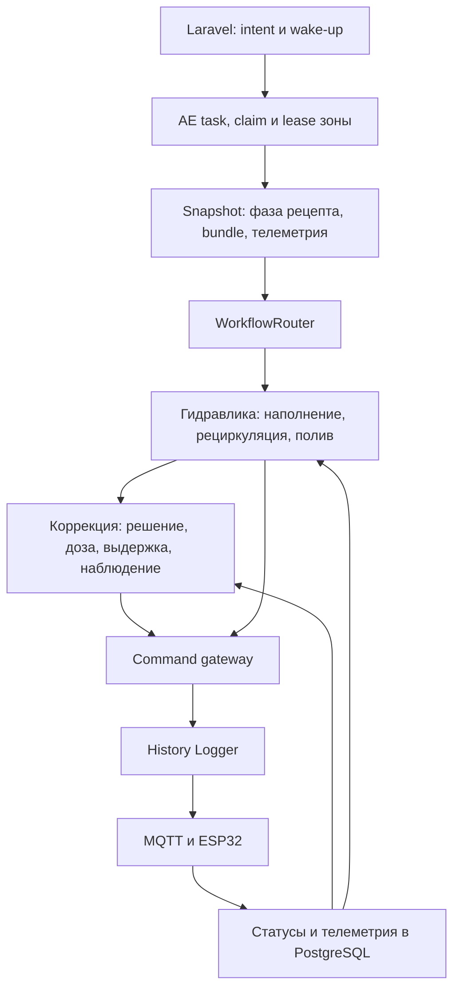

# Аудит AE3-Lite

**Дата:** 2026-10-18. **Проверенная ревизия:** `ba41c540`.

**Обновление 2026-10-19:** разделы 1–9 сохраняют результаты первоначального аудита.
Исправления в текущем рабочем дереве перепроверены и доработаны; актуальный статус
находится в разделе 10. Исходные ссылки на строки относятся к ревизии аудита.

Это отчёт об аудите существующего кода, а не новая спецификация или отметка о выполненных исправлениях. Runtime, конфигурация зон, рабочая БД и прошивки в рамках аудита не изменялись. Интеграционные проверки выполнялись в Docker с отдельной БД `hydro_test`.

## 1. Результат

Найдены **9 подтверждённых дефектов: 8 уровня P1 и 1 уровня P2**. P1 означает высокий приоритет исправления из-за нарушения учёта химии, аварийной остановки или работоспособности процесса; это не утверждение о произошедшей аварии на оборудовании.

Полный существующий набор `automation-engine/tests/unit` прошёл: **1751 passed за 60,74 с**. В этом каталоге находятся и интеграционные проверки PostgreSQL. Дополнительные воспроизведения показали, что зелёный набор не закрывает ряд переходов между компонентами и границ записи состояния.

Главная проблема — согласованность нескольких состояний одного физического процесса: стадия гидравлики, шаг питательного pipeline, подтверждённая команда, учтённая доза и результат химической коррекции. В обычном сценарии эти части работают вместе; при rollover окна, сокращении дозы, ручной паузе и сбое между SQL-записями расходятся.

| ID | Приоритет | Подтверждённый дефект | Проверка |
|---|---|---|---|
| A1 | P1 | Общая аварийная остановка исключает `valve_drain` | Выполнение builder + трассировка fail-path |
| A2 | P1 | Теряются и игнорируются process gains отдельных EC-компонентов | Snapshot-преобразование + настоящий planner |
| A3 | P1 | Повторное окно рециркуляции начинает pipeline с calcium | Инициализация handler + трассировка router |
| A4 | P1 | Между `DONE` и PID persistence остаётся невосстанавливаемое окно | Настоящий repository в `hydro_test` |
| A5 | P1 | После сокращённой дозы observe использует плановый объём | Настоящий handler с terminal feedback |
| A6 | P1 | Замороженный EC исключается из итоговой проверки целей | Настоящий target evaluator |
| A7 | P1 | Выход из `manual_hold` возвращает в check при остановленной гидравлике | Два последовательных handler-вызова |
| A8 | P1 | DLI читает через уже освобождённое SQL-соединение | Настоящий asyncpg pool + DLI reader |
| A9 | P2 | Нулевой cooldown долива превращается в 300 секунд | Настоящий guard с typed RuntimePlan |

## 2. Область и метод

Изучены `ae3lite/` и связанные тесты: ingress, создание/claim задач, worker, workflow router, topology packs, command gateway, startup/reconcile, snapshot и runtime monitor, гидравлические handlers, correction handler/planner, PID persistence, observation windows и runtime config. Особое внимание уделено `cycle_start`, `solution_topup`, `solution_change`, `irrigation_start` и переходам между ними.

Сверены основные контракты:

- [AE3-Lite](../04_BACKEND_CORE/ae3lite.md), [архитектурные потоки](../ARCHITECTURE_FLOWS.md).
- [Коррекция](../06_DOMAIN_ZONES_RECIPES/CORRECTION_CYCLE_SPEC.md), [effective targets](../06_DOMAIN_ZONES_RECIPES/EFFECTIVE_TARGETS_SPEC.md), [модель данных](../05_DATA_AND_STORAGE/DATA_MODEL_REFERENCE.md).
- [Открытый план исправлений](../../CORRECTION_PIPELINE_FIX_PLAN.md) — как перечень заявленных гарантий, с перепроверкой по коду.
- [Схема process calibration](../../schemas/zone_process_calibration.v1.json) и соответствующий read-path.

Точечно прочитана прошивка irrigation-ноды для уточнения `run_pump` и момента `DONE`. Полный аудит прошивок, Laravel, Vue, безопасности доступа и физического стенда сюда не входит. Не выполнялись рестарты рабочего AE, отправка device-команд, realhw YAML, Playwright или аудит истории рабочей БД. Выводы о физическом воздействии ниже — последствия достижимого поведения кода, а не замеры реальных баков.

## 3. Как устроен проверенный процесс



Для двух баков подготовка проходит через `startup`, наполнение чистого бака, наполнение бака раствора и рециркуляцию. При наполнении раствора разрешён calcium. Рециркуляция выполняет последовательность `Ca → pH → Mg → pH → NPK → pH → Micro → pH`.

Цели компонентов вычисляются от измеренного water baseline: `budget = target_ec − water_ec`. Например, при `water_ec=0.4`, `target_ec=1.8` и долях `0.2/0.1/0.6/0.1` цели равны `T_ca=0.68`, `T_ca_mg=0.82`, `T_ca_mg_npk=1.66`, `T_full=1.8`. Поэтому потеря номера текущего шага меняет смысл того же измерения EC.

Долив — отдельная задача для `ready`, с проверками уровней и cooldown. Смена раствора — отдельный workflow с подтверждениями оператора и стадией слива. `single_tank` использует значительную часть общих обработчиков; отсутствие `clean_fill_*` в графе само по себе не доказывает независимость остальных стадий от clean-датчиков.

Успех команды, готовность гидравлики и достижение химических целей — разные факты. `DONE` дозы подтверждает выполнение команды; `ready` — состояние workflow; `targets_achieved` должно подтверждаться свежими измерениями по разрешённым контурам. Остановка дозирования по лимиту компонента не подтверждает достижение полного EC.

## 4. Подтверждённые дефекты

### A1. Аварийная остановка не закрывает слив — P1

**Места:** [список fail-safe каналов](../../backend/services/automation-engine/ae3lite/application/services/correction_interrupt_safety.py#L57), [фильтр builder](../../backend/services/automation-engine/ae3lite/application/services/correction_interrupt_safety.py#L342), [контракт OFF для drain](../../backend/services/automation-engine/ae3lite/application/handlers/flow_path_guard.py#L65), [вызов общего shutdown](../../backend/services/automation-engine/ae3lite/application/use_cases/execute_task.py#L1661).

**Сценарий:** установка имеет привязанный `valve_drain`, `solution_change` открыла его, затем происходит exception, общий timeout задачи или восстановление после сбоя. Общий shutdown выбирает только шесть перечисленных irrig-каналов. Слив не входит ни в DB fallback, ни в сформированный OFF batch.

**Воспроизведение:** переданы актуаторы `pump_main` и `valve_drain`; `build_fail_safe_shutdown_commands()` вернул только `pump_main`.

**Последствие:** общий аварийный путь не посылает закрытие установленного сливного клапана. Штатный stage timeout с переходом в `solution_drain_timeout_stop` — другой путь и не является доказательством защиты от общего exception. Фактическое время открытого состояния зависит от локальных защит прошивки; здесь оно не измерялось.

**Исправление:** согласовать полный набор shutdown-каналов с зарегистрированными гидравлическими стадиями; включить drain и проверку OFF. Регрессия должна проходить от открытого слива через общий fail-path до сформированной stop-команды, включая DB fallback без snapshot.

### A2. Настройка gain отдельного компонента не управляет дозой — P1

**Места:** [bundle → calibration rows](../../backend/services/automation-engine/ae3lite/infrastructure/read_models/zone_snapshot_read_model.py#L529), [rows → snapshot](../../backend/services/automation-engine/ae3lite/infrastructure/read_models/zone_snapshot_read_model.py#L698), [принудительный single mode](../../backend/services/automation-engine/ae3lite/domain/services/correction_planner.py#L335), [single-component расчёт](../../backend/services/automation-engine/ae3lite/domain/services/correction_planner.py#L640), [generic gain](../../backend/services/automation-engine/ae3lite/domain/services/correction_planner.py#L1191).

Обнаружены две последовательные потери одного контракта:

1. `ec_component_gains` присутствует в authority-схеме и разрешён для редактирования, но оба snapshot-преобразования его не переносят.
2. Даже при прямой передаче этого поля planner-у `active_component` переводит расчёт в single mode, где `_compute_amount_ml()` использует общий `ec_gain_per_ml`. Компонентный resolver вызывается в multi-ветке, а не в каноническом последовательном pipeline.

**Воспроизведение:** generic gain `0.1`, magnesium gain `0.5`, EC `1.0 → 1.4`, `kp=1`, без интегрального вклада. Snapshot теряет компонентное поле; planner с явно переданным `active_component='magnesium'` выдаёт **4.0 мл вместо 0.8 мл**. Ограничения дозы могут уменьшить фактический импульс, но не восстанавливают правильный gain.

**Последствие:** сохранённая оператором калибровка компонента не влияет на канонический расчёт, нарушается модель размера дозы и её ожидаемого эффекта.

**Исправление:** сохранить поле по всему пути bundle → snapshot → typed runtime и использовать один компонентный gain в planner и observation. Нужен интеграционный тест с намеренно разными generic/Ca/Mg/NPK/Micro gains; тест только multi-mode эту ошибку не закрывает.

### A3. Повтор рециркуляции теряет прогресс компонентов — P1

**Места:** [очистка correction при transition](../../backend/services/automation-engine/ae3lite/application/use_cases/workflow_router.py#L550), [перезапуск окна](../../backend/services/automation-engine/ae3lite/application/handlers/prepare_recirc_window.py#L86), [начало pipeline с нулевого шага](../../backend/services/automation-engine/ae3lite/application/handlers/prepare_recirc.py#L406).

**Сценарий:** Ca и Mg уже внесены, выполняется NPK, истекает окно рециркуляции. Transition в `prepare_recirculation_window_exhausted` очищает `correction`. Следующее окно загружает baseline текущей задачи, но `_enter_recirc_pipeline_correction()` всегда выставляет `recirc_ca`, `active_component='calcium'` и сбрасывает dilute attempts.

**Воспроизведение:** инициализатор при переданном состоянии `recirc_npk` с валидным baseline вернул `recirc_ca`. Полный путь потери состояния дополнительно подтверждён вызовами router/window handler; физический rollover не запускался.

**Последствие:** EC `1.1`, нормальный для незаконченного NPK-шага с целью `1.66`, после rollover сравнивается с `T_ca=0.68` и выглядит как overshoot. Может начаться ненужное разбавление. При полном баке текущая реализация выдаёт `RECIRC_DILUTE_BLOCKED` и возвращается к ожиданию до ограничения окна; она не восстанавливает правильный компонент.

**Исправление:** сохранять шаг и необходимые накопленные данные между окнами одного приготовления. Новый water baseline и сброс прогресса должны соответствовать новой партии раствора, а не новому таймеру. Регрессия: rollover на NPK и на pH-gate после Mg, затем продолжение того же шага без повторного Ca/dilute.

### A4. `DONE` может остаться без учёта дозы в PID навсегда — P1

**Места:** [запись terminal command](../../backend/services/automation-engine/ae3lite/infrastructure/gateways/sequential_command_gateway.py#L1033), [последующая запись PID](../../backend/services/automation-engine/ae3lite/application/handlers/correction.py#L2043), [выборка reconciliation](../../backend/services/automation-engine/ae3lite/infrastructure/repositories/ae_command_repository.py#L584), [PID repair после reconcile](../../backend/services/automation-engine/ae3lite/application/use_cases/startup_recovery.py#L310).

**Сценарий:** gateway уже записал `ae_commands.terminal_status='DONE'`, но процесс завершился или PID persistence упала до сохранения `last_dose_at` и hold. Startup прерывает активную correction-задачу fail-closed. Terminal scan ищет только `publish_status='accepted' AND terminal_status IS NULL`, поэтому уже подтверждённая, но не учтённая доза исключена.

Та же граница есть внутри repair: command reconcile завершается раньше PID repair. Повтор после ошибки PID уже не выбирает эту строку.

**Воспроизведение в `hydro_test`:** terminal-задача с `accepted/NULL` выбиралась настоящим repository. После вызова `update_from_legacy(... DONE ...)`, без записи PID, выборка перестала её возвращать: `selected=False`, `pid_rows=0`. Тестовые сущности удалены. Рабочий процесс не останавливался; это модель состояния на границе сбоя.

**Последствие:** `last_dose_at`, hold и журнал PID могут не учитывать физически подтверждённую дозу. Это не доказательство автоматического повторного дозирования: startup fail-closed и аппаратные проверки дают дополнительную защиту, но обещание полного учёта доз нарушено.

**Исправление:** сделать учёт завершённой дозы отдельной идемпотентной обязанностью, не выводимой только из `terminal_status IS NULL`; обеспечить восстановление после сбоя между command/PID записями. Не отправлять дозу повторно ради восстановления учёта. Нужны fault-injection тесты до/после обоих коммитов и при падении самого repair.

**Смежные ограничения:** эта же выборка не включает `published_unconfirmed`; repair terminal-команд вызывается на startup, а периодический waiting-command reconcile работает с `waiting_command` задачами. Для позднего `DONE` уже terminal-задачи нужен отдельно проверенный повторный проход.

### A5. Observe и обучение используют объём до ограничения нодой — P1

**Места:** [разбор EC feedback](../../backend/services/automation-engine/ae3lite/application/handlers/correction.py#L1971), [следующее EC-состояние](../../backend/services/automation-engine/ae3lite/application/handlers/correction.py#L2061), [следующее pH-состояние](../../backend/services/automation-engine/ae3lite/application/handlers/correction.py#L2221), [объём для observation](../../backend/services/automation-engine/ae3lite/application/handlers/correction.py#L3499).

**Сценарий:** нода возвращает `DONE` с `duration_limited=true`. Handler пересчитывает фактические миллилитры, корректно пишет событие и `last_output_ms`, но single-dose ветки не заменяют `corr.ec_amount_ml` / `corr.ph_amount_ml` на подтверждённый объём.

**Воспроизведение:** расширена проверка результата существующих тестов duration-limited feedback. Для EC при плане **5 мл** и feedback **2.5 мл** следующее correction-состояние содержит **5 мл**. Для pH при плане **4 мл** и feedback **3 мл** остаётся **4 мл**.

**Последствие:** observe считает ожидаемый эффект, no-effect threshold и learned gain по неправильной дозе. Возможны ложные no-effect и искажённое обучение. Для EC cross-coupling также вычисляется из прежнего `corr`. В multi-sequential ветке есть отдельная поправка объёма; находка относится к single-dose веткам, используемым каноническим component pipeline.

**Исправление:** до расчёта feedforward и перехода в wait сохранить фактический объём в состоянии наблюдения. Регрессия должна проверять следующий observe и learned gain, а не только event и `last_output_ms`.

### A6. Исчерпание EC budget может превратиться в `targets_achieved` — P1

**Места:** [переход к pH-only после ограничения EC](../../backend/services/automation-engine/ae3lite/application/handlers/correction.py#L707), [исключение frozen EC из target evaluator](../../backend/services/automation-engine/ae3lite/application/handlers/base.py#L1629), [deadline outcome коррекции](../../backend/services/automation-engine/ae3lite/application/handlers/correction.py#L2987).

**Сценарий:** на поливе разрешён EC-компонент `calcium` или `npk`, но его budget исчерпан либо baseline непригоден. Handler правильно блокирует дальнейшее внесение и продолжает pH, выставляя `ec_pid_frozen=True`. Если завершение оценивается в этом состоянии, `_target_outcome_snapshot()` исключает EC из списка проверяемых целей.

**Воспроизведение:** одни и те же значения pH `6.0`, EC `0.5`, цели `6.0/1.8`, компонент `calcium`:

| `ec_pid_frozen` | Chemistry outcome | `current_ec` в результате |
|---|---|---|
| `false` | `targets_not_achieved` | `0.5` |
| `true` | `targets_achieved` | `null` |

**Последствие:** ограничение возможности дозировать подменяет проверку достигнутого результата. Ранее записанный component-budget warning не делает последующий `targets_achieved` корректным. Явный операторский `irrigation_ec_component=none` — отдельный допустимый pH-only режим; его нельзя смешивать с вынужденной блокировкой включённого EC.

**Исправление:** разделить enabled, dosing-blocked и target-reached. Продолжать pH разрешено, но итог по включённому EC должен сохранять недостижение/неизвестность и причину блокировки. Регрессия: deadline после budget exhaustion и после missing/stale baseline.

### A7. Ручная пауза не восстанавливает остановленный flow-path — P1

**Места:** [возврат из manual hold](../../backend/services/automation-engine/ae3lite/application/handlers/manual_hold.py#L43), [проверка включённого fill до manual step](../../backend/services/automation-engine/ae3lite/application/handlers/solution_fill.py#L91), [ожидаемый ON при recirc](../../backend/services/automation-engine/ae3lite/application/handlers/prepare_recirc.py#L125).

**Сценарий:** flow interrupt выключает насос и клапаны и сохраняет `__mh_return:solution_fill_check`. Затем оператор возвращает `auto`. `ManualHoldHandler` переходит прямо к check, не выполнив start plan. Check требует ON. Аналогичный возврат используется для других flow-check стадий; recirc имеет backoff/rollover, но тоже не получает нормального resume из hold.

**Воспроизведение:** `ManualHoldHandler` вернул `solution_fill_check`, число отправленных команд — `0`. Следующий настоящий `SolutionFillCheckHandler` со свежим OFF snapshot завершился `irr_state_mismatch`. С ручным `solution_fill_stop` в заполнении есть дополнительная проблема: обработка pending step расположена после ON probe.

**Исправление:** задать явную политику resume/stop с повторной проверкой уровней, дедлайнов и действующего разрешения оператора. Для resume выполнять подходящую start-стадию; для stop не требовать предварительно работающий насос. Тестировать последовательность interrupt → hold → auto/manual action → следующий tick с реальным OFF snapshot.

### A8. Положительный DLI target ломает общий snapshot зоны — P1

**Места:** [граница acquire в snapshot](../../backend/services/automation-engine/ae3lite/infrastructure/read_models/zone_snapshot_read_model.py#L63), [вызов после выхода из acquire](../../backend/services/automation-engine/ae3lite/infrastructure/read_models/zone_snapshot_read_model.py#L410), [SQL в DLI reader](../../backend/services/automation-engine/ae3lite/infrastructure/read_models/dli_light_series.py#L39).

**Сценарий:** у фазы задан положительный `dli_target`. `PgZoneSnapshotReadModel.load()` выходит из `async with pool.acquire()`, затем передаёт старый `conn` в `load_dli_light_series()`. При выключенном DLI ранний return скрывает проблему; при включённом выполняется SQL.

**Воспроизведение с настоящим asyncpg pool:** `InterfaceError: cannot call Connection.fetch(): connection has been released back to the pool`.

**Последствие:** падает общий snapshot, используемый не только lighting, но и задачами баков/полива этой зоны. Тесты DLI рассчитывают результат на готовом snapshot; существующий snapshot integration не задаёт положительный DLI target.

**Исправление:** читать ряд внутри действующего connection context, сохранив выбранную семантику согласованности snapshot. Регрессия должна вызвать полный `PgZoneSnapshotReadModel.load()` на PostgreSQL при положительном DLI.

### A9. Нулевой cooldown долива не соблюдается — P2

**Место:** [чтение cooldown](../../backend/services/automation-engine/ae3lite/application/handlers/solution_topup.py#L87).

Typed config допускает `solution_topup_cooldown_sec=0`, и `_cooldown_active()` умеет обрабатывать ноль. Но вызывающий код использует `value or 300`, поэтому явное отключение задержки заменяется пяти минутами.

**Воспроизведение:** валидный RuntimePlan с нулём передал в cooldown-check `300`. При активном интервале guard выдаёт `start_solution_topup_cooldown_active`.

**Исправление:** различать `None` и `0`; проверить реальный guard с недавним событием завершения предыдущего долива и конфигурациями `0`, положительное значение, отсутствующее значение на разрешённой границе конфигурации.

## 5. Что подтверждено положительно

- Команды рассмотренных workflow проходят через gateway и History Logger. Прямой MQTT publish в проверенных runtime-путях не обнаружен.
- Claim/lease, поколения claim, атомарные task/workflow переходы и запрет успеха mutating-команд по одному ACK представлены в коде и покрыты прошедшими тестами. Это не заменяет аппаратный fencing; production-контракт одной реплики сохраняется.
- Для pH/EC используются окна `telemetry_samples`, проверки свежести, временного покрытия, стабильности и физических границ. Есть отрицательные сценарии для stale/stub/future samples и неготовых окон.
- Исправления admission новой дозы перед deadline, ожидания terminal и привязки выдержки к завершению команды присутствуют. A4 и A5 показывают оставшиеся границы учёта после terminal.
- Success evaluator и dose planner используют PID deadband; широкий recipe range больше не должен автоматически означать успех. A6 — отдельный обход через состав проверяемых контуров.
- Persistent sensor mode имеет защиту от повторной нормальной активации. При неполных окнах остаются отдельные recovery-ветки.
- Для пустого раствора, утечки, stale уровней, E-Stop, лимита no-effect и потери lease есть fail-closed ветки. A1 и A7 показывают, почему наличие таких веток нужно проверять вместе с полным набором каналов и следующим состоянием.

## 6. Открытые вопросы и эксплуатационные ограничения

Эти пункты не включены в девять дефектов как доказанные аварийные сценарии.

1. **Химия при timed irrigation.** Default `irrigation_start` использует `pump_main/run_pump`. CommandHandler ждёт terminal `DONE`; firmware для duration-команд возвращает сначала ACK, затем DONE по завершению. Поэтому `irrigation_check` выполняется после насосного импульса и прямо ожидает `pump_main=False`. Клапаны могут оставлять самотёчный путь, что отдельно предусмотрено firmware. Нужно подтвердить на конкретной гидравлике поток, перемешивание и доставку реагента в это время; нельзя считать весь `duration_sec + correction_slack_sec` гарантированным временем работы насоса.
2. **`single_tank`.** Общий `SolutionFillCheckHandler` продолжает проверять `clean_min` и ожидает `valve_clean_supply`. Нужен сквозной сценарий с реально отсутствующим clean-баком и его датчиками; одних topology registry tests недостаточно. Внешний источник воды с отдельным min-сигналом может быть допустимым вариантом установки, поэтому требование к датчику нужно решить явно.
3. **Граница партии раствора.** После `solution_min → startup` в пределах той же задачи нужно проверить, когда переизмеряется baseline и сбрасывается состояние компонентов/PID. Правило «baseline только текущей task» защищает от чужого цикла, но само по себе не доказывает, что внутри task осталась та же партия воды.
4. **Калибровки и измерения на стенде.** Не проверялись реальные `ml_per_sec`, соответствие NodeConfig, транспортные задержки, перемешивание, дискретные уровни, размещение датчиков и физический no-effect. Зелёный mock-тест не подтверждает эти параметры.
5. **Частичные firmware-возможности.** Drain должен реально поддерживаться привязанной нодой. Наличие `solution_change` в AE-графе и `valve_drain` в test-node не является проверкой комплектности конкретной production-ноды.

## 7. Перепроверка CORRECTION_PIPELINE_FIX_PLAN.md

| Заявленная гарантия | Результат аудита |
|---|---|
| Полный automation-engine suite зелёный | Подтверждено повторным запуском: 1751 passed |
| Admission учитывает время дозы до публикации | Механизм и тесты присутствуют |
| DONE отражается в PID и actual-dose учёте | Неполно: A4, A5 |
| Недостижение EC всегда видно в terminal chemistry outcome | Неполно: A6 |
| Persistent sensor mode не активируется перед каждой нормальной дозой | Соответствующий механизм присутствует, тесты прошли |
| Deadband planner и success согласованы | Основной механизм есть; A6 меняет состав контролируемых целей |
| Компонентный budget не позволяет бесконтрольно закрыть полный EC одним реагентом | Ограничитель есть; нельзя трактовать его срабатывание как достигнутый полный target |
| Realhw подтверждает результат | Не подтверждалось в этом аудите; пункт плана остаётся открытым |

Отметки о выполнении плана не следует трактовать как закрытие новых сценариев A1–A9. Исходный план в рамках аудита не редактировался.

## 8. Проверки и воспроизведения

Выполненная команда полного набора:

```bash
docker exec -e AE3_PYTEST_DB=hydro_test backend-automation-engine-1 \
  pytest -q -p no:cacheprovider tests/unit
```

Результат: `1751 passed in 60.74s (0:01:00)`.

Перед запуском прочитан `automation-engine/conftest.py`: он принудительно устанавливает тестовую БД и запрещает имена рабочих БД. Для отдельных Python-воспроизведений явно задавались `PG_DB=hydro_test`, `DB_DATABASE=hydro_test`, при использовании test helpers — `PYTHONPATH=/app:/app/tests/unit`. Команды к устройствам заменялись mock gateway; A4 использовал реальные SQL repositories и тестовые сущности с уникальным префиксом и cleanup. A8 использовал настоящий pool и не выполнял изменения данных.

Контрольные результаты дополнительных воспроизведений:

```text
FAILSAFE_INPUT: pump_main, valve_drain
FAILSAFE_OUTPUT: ['pump_main']
SNAPSHOT_COMPONENT_GAINS: None
FORCED_MAGNESIUM: dose_ml=4.0, component_gain_expected_ml=0.8
PIPELINE_REENTER: recirc_npk -> recirc_ca calcium
PID_RECOVERY_BEFORE_DONE: True
PID_RECOVERY_AFTER_DONE: False, pid_rows=0
PARTIAL_EC: confirmed_ml=2.5, next_state_ml=5.0
PARTIAL_PH: confirmed_ml=3.0, next_state_ml=4.0
EC_OUTCOME frozen=False: targets_not_achieved, current_ec=0.5
EC_OUTCOME frozen=True: targets_achieved, current_ec=None
MANUAL_RESUME: solution_fill_check, commands_sent=0
NEXT_TICK: irr_state_mismatch
DLI: InterfaceError — connection has been released back to the pool
TOPUP_COOLDOWN: configured=0, actual=300
```

Это диагностические пробы текущего поведения, а не добавленные в репозиторий regression-тесты. Для исправлений нужно перенести сценарии в основной набор с утверждениями о правильном поведении. При A3 отдельно нужен полный тест rollover через repository/router, а при A4 — управляемый сбой процесса/записи, не только моделирование сохранённых строк.

## 9. Приоритеты исправления

1. **Аварийная остановка и достоверный учёт:** A1, A4, A5. Сначала доказать закрытие всех путей воды и восстановимость подтверждённой дозы.
2. **Математика и непрерывность приготовления:** A2, A3. Пронести компонентные gains и сохранить прогресс одной партии между окнами.
3. **Достоверность результата и управление:** A6, A7. Разделить запрет дозы и результат измерения; проверить весь цикл ручной паузы.
4. **Независимые ошибки:** A8, A9. Исправить lifetime соединения и семантику нулевого cooldown.
5. После targeted и полного suite — узкие realhw-сценарии: rollover на NPK, сокращённая доза, поздний DONE/restart, остановка слива, manual hold/resume, EC budget exhaustion. Запускать по [realhw guide](REALHW_TEST_NODE_AGENT_GUIDE.md), MQTT `1884`, без node-sim и без полного набора «на всякий случай».

Критерий закрытия аудита — не только повторно зелёные 1751 тест, но и новые регрессии для каждого сценария, согласованные canonical контракты и отдельная проверка физического поведения. Исправления должны расширять существующий AE3-Lite, сохраняя History Logger как единственную точку публикации device-команд.

## 10. План устранения

Исправления расширяют текущий AE3-Lite. Новых сервисов, `task_type` и прямого MQTT нет. Учёт дозы восстанавливается без повторной отправки команды.

| Поток | Дефекты | Файлы | Критерий |
|---|---|---|---|
| Авария и cooldown | A1, A9 | `correction_interrupt_safety.py`, константа каналов в `execute_task.py`, `solution_topup.py` | Общий shutdown закрывает `valve_drain`. `cooldown_sec=0` не подменяется на 300 |
| Snapshot и gain | A2, A8 | `zone_snapshot_read_model.py`, `correction_planner.py`, при необходимости `dli_light_series.py` и observation gain | Компонентный gain доходит до single-dose. DLI читается внутри живого connection |
| Партия и пауза | A3, A7 | `prepare_recirc.py`, `prepare_recirc_window.py`, `manual_hold.py`, `solution_fill.py` | Rollover окна продолжает тот же шаг pipeline. Resume из `manual_hold` поднимает start-стадию, stop не требует уже включённый насос |
| Учёт химии | A4, A5, A6 | `correction.py`, `ae_command_repository.py`, `startup_recovery.py`, `base.py` | DONE без PID подхватывается идемпотентно и не дозируется повторно. Observe учится на фактических мл. Frozen EC не становится `targets_achieved` |

Каждый поток закрывается регрессией из раздела 8. После слияния — полный `tests/unit` automation-engine на `hydro_test`.

## 10. План устранения

Исправления расширяют текущий AE3-Lite. Новых сервисов, `task_type` и прямого MQTT нет. Учёт дозы восстанавливается без повторной отправки команды.

| Поток | Дефекты | Файлы | Критерий |
|---|---|---|---|
| Авария и cooldown | A1, A9 | `correction_interrupt_safety.py`, константа каналов в `execute_task.py`, `solution_topup.py` | Общий shutdown закрывает `valve_drain`. `cooldown_sec=0` не подменяется на 300 |
| Snapshot и gain | A2, A8 | `zone_snapshot_read_model.py`, `correction_planner.py`, при необходимости `dli_light_series.py` и observation gain | Компонентный gain доходит до single-dose. DLI читается внутри живого connection |
| Партия и пауза | A3, A7 | `prepare_recirc.py`, `prepare_recirc_window.py`, `manual_hold.py`, `solution_fill.py` | Rollover окна продолжает тот же шаг pipeline. Resume из `manual_hold` поднимает start-стадию, stop не требует уже включённый насос |
| Учёт химии | A4, A5, A6 | `correction.py`, `ae_command_repository.py`, `startup_recovery.py`, `base.py` | DONE без PID подхватывается идемпотентно и не дозируется повторно. Observe учится на фактических мл. Frozen EC не становится `targets_achieved` |

Каждый поток закрывается регрессией из раздела 8. После слияния — полный `tests/unit` automation-engine на `hydro_test`.

## 11. Статус кода

Исправления A1–A9 внесены в `ae3lite` без нового сервиса, `task_type` и прямого MQTT. Повторный прогон:

```bash
docker compose -f backend/docker-compose.dev.yml exec -T -e AE3_PYTEST_DB=hydro_test \
  automation-engine pytest -q -p no:cacheprovider tests/unit
```

Результат: **1791 passed** (до правок в этом аудите было 1751). Realhw из раздела 9.5 не запускался.

Compatible-With: Protocol 2.0, Backend >=3.0, Python >=3.0, Database >=3.0, Frontend >=3.0

## 10. Проверка исправлений — 2026-10-19

До этой проверки рабочее дерево уже содержало исправления A1–A9 и дополнительные
изменения guards/PID. Исходный набор прошёл: `1795 passed`. Проверка продолжена
сквозными тестами PostgreSQL и сценариями последовательных переходов.

| Пункт | Проверенное состояние и доработка |
|---|---|
| A1 | Drain включён в общий набор shutdown и DB fallback; ExecuteTask использует тот же набор |
| A2 | Компонентные gains проходят bundle → snapshot; planner и observe используют один resolver |
| A3 | Прогресс сохраняется и читается между окнами. Исправлена двойная JSON-сериализация baseline; запись resume перенесена в транзакцию stage/workflow после claim fencing. Проверены rollback, устаревший claim и повторный вход на NPK, включая старый JSON-string baseline |
| A4 | DONE без учёта остаётся в repair. До publish сохраняется локальный hold context; recovery восстанавливает hold обоих контуров после EC и не сокращает более новый hold. Добавлен периодический repair позднего DONE без повторного active-task startup recovery |
| A5 | Подтверждённый объём используется состоянием observe, обучением и feedforward. Доработана также parallel-ветка |
| A6 | Frozen EC остаётся в проверке полного target. Устранён обратный дефект: реально достигнутый target больше не объявляется недостигнутым только из-за запрета дозы |
| A7 | Fill/recirc возобновляются через start со свежими уровнями; deadline/retry/guard clock сохраняются. Прерванный полив заканчивается с chemistry outcome без повторной подачи. Stop разрешён без ON probe; прогресс recirc сохраняется также при hold |
| A8 | DLI читается внутри acquire/transaction; интеграционный snapshot проверен с положительной целью DLI |
| A9 | Явный нулевой cooldown сохраняется |

Дополнительно обнаружен и исправлен дефект SQL-upsert PID: INSERT-default `0`
через `EXCLUDED` заменял непереданные integral, derivative, last_output_ms,
feedforward_bias и no_effect_count при частичном UPDATE. Регрессия в PostgreSQL
до исправления воспроизвела `integral: 1.25 → 0.0` после одного обновления времени
измерения. Теперь отсутствующее поле сохраняется, явный `0` сбрасывает значение.

Канонические correction/effective-targets/AE3/data-model документы синхронизированы.
Внешние API, MQTT и HL params не менялись; новые поля находятся в существующем
локальном JSONB. Новых сервисов, task types и миграций нет.

Ограничения: рабочий AE не перезапускался, команды на оборудование не отправлялись.
Realhw-пункты исходного плана остаются открытыми. У старых команд без сохранённого
dose context точную историческую выдержку нельзя восстановить из утраченного config;
repair использует доступную stabilization policy задачи и сохраняет уже записанный hold.
